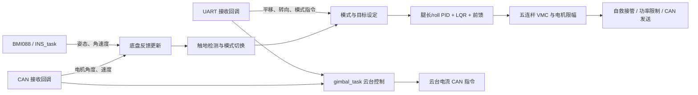

# 轮腿底盘控制工程

统一入口是根目录 CMake。现有底盘业务代码、TinyMPC 求解模块和验证程序分别构建，编译产物统一放在 `build/`。

底盘控制的阅读顺序、参数快照及腿长/roll/跟随/前馈的历次调试记录见 [log/README.md](log/README.md)。

## 先看工程如何运行

实车控制入口是 **`lqr` 固件**。`host` 是电脑上的算法验证，`mpc-probe` 是独立板端测量程序；当前实车没有用 TinyMPC 替换 LQR。

启动顺序：

```text
platform/stm32f407/startup_stm32f407xx.s
  → SystemInit / C 运行时
  → platform/stm32f407/src/main.c
      HAL_Init → 时钟 → GPIO/CAN/SPI/UART/定时器等外设
      → can_filter_init / remote_control_init 等应用准备
      → MX_FREERTOS_Init → osKernelStart
          → INS_task       姿态估计
          → chassis_task   底盘控制
          → gimbal_task    云台 yaw / 发射控制
          → UART_RECEIVE   板间通信发送，接收在 UART 回调中处理
          → 裁判系统、电压、OLED、LED 等辅助任务
```

线程是否真正创建以 [freertos.c](platform/stm32f407/src/freertos.c) 为准，源文件存在不代表任务正在运行。例如检测、标定、独立 CAN 任务的创建目前被注释。`motor_cmd_task` 目前主要更新超电状态字段，实际底盘电机发送在 `chassis_task.c` 的 `Motor_CMD_Send()`，不能只按任务文件名判断职责。

### 数据从哪里来，到哪里去



| 数据 | 生产位置 | 底盘怎样使用 |
| --- | --- | --- |
| IMU 姿态/角速度 | [INS_task.c](src/application/INS_task.c)：BMI088 采集与 AHRS | 通过 getter 获取反馈指针，用于机身姿态和对地腿角 |
| 电机测量值 | [can_service.c](src/service/CanService/can_service.c)：CAN 接收回调解包 | 换算轮速、关节角度与角速度，随后做五连杆正解 |
| 板间控制指令 | [uart_receive.c](src/application/uart_receive.c)：USART1 回调更新 `uart_data` | `chassis_data_` 指向收到的底盘命令；跟随还读取云台相对编码器角度 |
| 底盘控制状态 | `chassis_move`，由底盘任务更新 | 含模式、姿态、腿部、电机、PID 与力矩结果；云台任务也读取部分状态 |
| 电机指令 | `Motor_CMD_Send()` / `gimbal_task()` | 通过 CAN service/BSP 发给关节、轮毂和云台电机 |

这些共享数据沿用现有任务/回调访问方式，本轮整理没有将它们改为原子快照或消息队列。

### 底盘一拍的控制流程

从 [chassis_task.c](src/application/chassis_task.c) 中的 `chassis_task()` 顺着看即可；参数声明在文件顶部，私有衔接函数在文件后部。

| 顺序 | 任务内入口 | 实际工作 |
| --- | --- | --- |
| 1 | `chassis_feedback_update()` | 测量本周期 dt、应用在线积分参数、读取电机/IMU、轮速积分、左右腿正解、合成对地腿角 |
| 2 | `Chassis_Status_Detect()`、模式切换函数 | 检测接地状态，处理使能、起立、普通运动和跳跃阶段 |
| 3 | `Target_Value_Set()`、`chassisClimbProcess()` | 生成平移/腿长/yaw 目标，管理停车位置与云台跟随，处理越障目标接管 |
| 4 | `Chassis_Torque_Calculation()` | 更新姿态参考，计算腿长/roll 支撑及 LQR 反馈分量；保留跳跃/离地分支 |
| 5 | `chassis_apply_com_feedforward()`、`Chassis_Torque_Combine()` | 叠加实验前馈，把虚拟腿支撑力/平衡力矩映射为关节电机力矩，合成轮端输出 |
| 6 | `chassisRecoveryProcess()`、`chassis_power_limit()`、`Motor_CMD_Send()` | 自救时接管输出，再限功率并发送电机指令 |

`CHASSIS_CONTROL_TIME_MS=2` 是循环末尾的等待，不等于整拍耗时。电机发送内还有等待，所以里程、跟随斜率和姿态参考使用 `chassis_control_dt_s` 实测间隔。它在反馈阶段统一更新，算法里不各自读取时钟。旧腿部微分与 PID 仍有固定周期约定，本次未重写它们。

### 算法、控制器和功能模块的边界

按“负责什么”分类，避免把所有带 chassis 名称的文件都放进功能模块目录：

| 层 | 目录 | 职责与依赖 |
| --- | --- | --- |
| 任务编排 | `src/application/` | 读硬件/通信状态，选择模式，组装算法输入，控制执行顺序并发送结果 |
| 功能行为 | `src/module/chassis/` | 跟随、停车、接地、越障、自救等运行条件与动作状态；由任务接入 |
| 控制器 | `src/components/controller/` | PID、平衡参考/反馈/前馈及 MPC 求解；输入数值状态，输出参考或控制量 |
| 数学算法 | `src/components/algorithm/` | 五连杆正解、雅可比、VMC 数学、LQR 增益拟合、滤波和通用运算 |
| 通信与驱动 | `src/service/`、`src/protocols/`、`src/bsp/`、`platform/` | 协议、外设、板级初始化与测量值接入 |

本轮新整理的 `chassis_balance`、`chassis_leg_math` 和独立 MPC 不包含 HAL、FreeRTOS 或 application 头文件，不直接访问 `chassis_move`。现有接地、越障、自救模块仍依赖任务状态结构，尚未完全解耦。

各文件的位置与职责如下：

| 文件 | 放在一起的内容 | 阅读时注意 |
| --- | --- | --- |
| [algorithm/chassis_leg_math.c/.h](src/components/algorithm/chassis_leg_math.h) | 五连杆正解、完整逆雅可比、VMC 力/力矩映射，含连杆尺寸 | 纯数学，既不读 IMU，也不发 CAN；第一/第二关节左腿为电机 1/2，右腿为 4/3 |
| [chassis_motion.c/.h](src/module/chassis/chassis_motion.h) | 左右轮速里程 + 松杆停车位置捕获 | 轮速里程没有融合定位；捕获位置后由 LQR 保持，没有另加位置 PID |
| [controller/chassis_balance.c/.h](src/components/controller/chassis_balance.h) | 独立姿态参考 + LQR 分量计算 + 质心力矩前馈 | 是控制计算，不负责起立/跳跃模式；电机方向和最终限幅在任务处理，VMC 数学在 algorithm |
| [controller/chassis_mpc/](src/components/controller/chassis_mpc/) | 独立 MPC C 接口、求解结果检查与生成缓存 | 输入状态和参考，输出模型控制量；目前用于电脑验证/独立板端测量，未接管实车 |
| [chassis_follow.c/.h](src/module/chassis/chassis_follow.h) | 云台跟随、手动转向接管、松杆减速、停止航向保持 | 编码器角差用 deg，底盘 yaw 用 rad；输出给 LQR，不直接驱动电机 |
| `chassis_contact.c/.h` | 接地判定及离地处理 | 决定普通平衡、跟随和前馈能否继续工作 |
| `chassis_climb.c/.h`、`chassis_recovery.c/.h` | 越障与倒地自救状态机 | 属于完整特殊动作，按阶段接管目标或输出 |
| `chassis_power.c/.h` | 现有功率相关功能接入 | 当前实现缩放速度参考，并不直接裁剪电机力矩；调用顺序保留，不能将函数名当作实际功率闭环保证 |

原来空的 `chassis_slip.c/.h` 已移除，当前没有打滑模块实现。`src/module/gimbal/` 暂未形成实际模块，云台现有控制入口仍在 `src/application/gimbal_task.c`。

小段参数回填和模式判断留在任务私有函数中；能独立描述输入/输出的数学、跟随和状态机才分文件。上一轮的 `chassis_control.c/.h`、`chassis_tuning.c/.h` 已收回，不再为它们维护一层独立应用接口。

### 改什么，先看哪里

| 需求 | 入口 |
| --- | --- |
| 腿长/roll PID、在线参数声明 | [chassis_config.h](src/application/chassis_config.h)；`tune_*` 定义在 `chassis_task.c` 顶部 |
| 跟随响应、角差处理、进入/退出条件 | `chassis_follow.c/.h`；接入点 `chassis_update_yaw_follow()` |
| 停车回退、轮速里程 | `chassis_motion.c/.h`；接入点 `chassis_update_wheel_odometry()` 和 `chassis_update_stop_position()` |
| pitch/腿角参考、质心前馈 | `chassis_balance.c/.h` 与任务内对应 `tune_*` |
| LQR 增益拟合与力矩分量 | [LQR.c](src/components/algorithm/LQR.c)、`chassis_balance.c`、任务内 `Chassis_Torque_Calculation()` |
| 五连杆尺寸、速度解算、雅可比与力矩映射 | `chassis_leg_math.c/.h` |
| 起立/跳跃/失能 | 任务内模式切换；特殊动作另看 climb/recovery |
| 云台自己的 yaw 控制器 | [gimbal_task.c](src/application/gimbal_task.c)，与底盘跟随外环分别调试 |
| 引脚/时钟/外设 | `platform/stm32f407/`；CubeMX 参考文件在其 `cubemx/` 子目录 |
| 任务栈与优先级 | `platform/stm32f407/src/freertos.c` |

**本轮已将源码的 pitch 默认参考偏移固化为 0 rad**，位置在 `src/components/controller/chassis_balance.h`。对地腿角编译默认仍为 0.1072 rad，前馈默认关闭；未将试调的腿角 0.1172 顺带固化。新固件烧录后，复位保持 pitch 零偏移。本轮未烧录，因此板上旧固件仍受原默认值影响；此前 RAM pitch=0 与新源码默认值是两回事。参数历史见 [调试日志](log/README.md)。

## 编译器与构建系统

CMake 管理源文件、依赖、编译参数与链接命令，仍然需要编译器。当前 TinyMPC/Eigen 无法用已有 ARMCC5 编译；改为 CMake 不会消除这个限制。

本工程采用 **CMake + Ninja + ARM Compiler 6（armclang / armasm / armlink）** 构建板端，电脑验证使用原生 GCC。当前工程不再包含 Keil IDE 工程文件，仍需要安装并授权 ARM Compiler 6 工具链。

暂不提供完整固件的 GNU Arm 构建配置：现有 `AHRS.lib`、DSP 库、启动汇编、散装加载文件和 RTOS 端口都与 ARM 工具链有关，不能仅切换一个编译器路径。已安装 GNU Arm 工具链不等于这项迁移已经完成。

## 构建目标

| 配置 | 用途 | 输出 |
| --- | --- | --- |
| `host` | double/float TinyMPC 与独立 QP 对照、失败保护、线性模型闭环回放 | `build/host/mpc_probe_*.exe`、`reports/comparison.json` |
| `lqr` | 原底盘应用的完整 ARMClang 固件，使用现有 LQR 控制路径 | `build/lqr/chassis_firmware.{elf,hex,bin,map}` |
| `mpc-probe` | 独立 MPC 板端测量固件，不启动底盘任务或电机外设 | `build/mpc-probe/chassis_firmware.{elf,hex,bin,map}` |

### 电脑验证

需要 Python、NumPy/SciPy、CMake、Ninja、原生 g++。从工程根目录执行：

```powershell
python tools/chassis/mpc/run_host_checks.py
# 编译器未自动发现时：
python tools/chassis/mpc/run_host_checks.py --cxx 'D:/your-mingw/bin/g++.exe'
```

脚本默认验证已提交的生成数据。修改模型或求解配置后，显式执行 `--regenerate`；模型参数变动后必须重新做数值验证。依赖列表见 `tools/chassis/mpc/requirements.txt`。

配置完成后也可以使用：

```powershell
cmake --build --preset host
ctest --preset host
```

### 板端固件

安装并授权 ARM Compiler 6；本机验证使用 6.7。PowerShell 示例：

```powershell
$env:ARMCLANG_ROOT = 'D:/Keil5/ARM/ARMCLANG'
cmake --preset lqr
cmake --build --preset lqr

cmake --preset mpc-probe
cmake --build --preset mpc-probe
```

两个固件拥有各自的启动代码与完整链接结果；分别使用独立构建目录。`mpc-probe` 的 `main` 在 SystemInit 后的默认 HSI 时钟下执行一次求解，结果保存在 `whu_mpc_probe_record`，随后等待中断。这个测试耗时不能当成 168 MHz、RTOS 并发下的耗时。`sequence == 1` 才表示测量已经完成。

探针保留 8 KiB 主栈、32 KiB C/C++ 堆；这是预留预算，实际峰值还需板端测量。现有启动文件不传配置时保持原有 8 KiB 堆。FreeRTOS 的 `heap_4` 与 C++ malloc/new 使用的堆分别管理。

## 文件职责

| 目录 / 文件 | 职责 |
| --- | --- |
| `src/application/` | RTOS 任务、底盘/云台控制编排及 `chassis_config.h` 参数入口 |
| `src/bsp/` | 板载设备与通信驱动封装 |
| `src/components/algorithm/` | 五连杆/雅可比/VMC、LQR 拟合、滤波等数值算法 |
| `src/components/controller/` | PID、底盘平衡控制计算及独立 MPC 求解器 |
| `src/components/devices/`、`src/components/UI/` | 传感器/显示设备与 UI 组件 |
| `src/protocols/`、`src/service/` | 通信协议与共享服务 |
| `src/module/chassis/` | 运动/停车、跟随、接地、功率、自救、越障等功能模块 |
| `third_party/` | STM32 HAL、CMSIS、FreeRTOS、TinyMPC 及其许可证 |
| `tools/chassis/` | 模型导出、缓存生成、电脑仿真与板端测试入口 |
| `platform/stm32f407/` | 启动汇编、链接布局、板级源文件/头文件、探针入口与协议布局检查 |
| `platform/stm32f407/cubemx/` | 保留的 CubeMX 引脚与时钟配置参考 |
| `cmake/` | MPC 库目标、显式固件源文件清单、工具链配置 |
| `log/` | 参数试调反馈、结构调整记录与后续日志模板 |
| `build/` | 当前构建、日志、数值报告，不属于源代码 |

目录结构：

```text
chassis_mpc/
├── src/
│   ├── application/     chassis_task、chassis_config、gimbal_task、INS_task、通信等
│   ├── module/chassis/  motion、follow、contact、climb、recovery、power
│   ├── components/
│   │   ├── algorithm/  五连杆数学、LQR 拟合、AHRS、滤波等
│   │   ├── controller/ PID、chassis_balance
│   │   │   └── chassis_mpc/ 独立 MPC C 接口与生成缓存
│   │   ├── devices/    BMI088、磁力计、OLED 等设备
│   │   └── UI/         UI 组件
│   ├── service/        CAN 解析/发送与共享服务
│   ├── protocols/      板间、裁判系统、超电等协议
│   └── bsp/            板载外设封装
├── platform/stm32f407/  MCU 启动、板级代码和配置
├── third_party/         第三方源码
├── tools/chassis/       模型导出和验证工具
├── cmake/               构建规则与工具链
├── log/                 历次更改、参数与实测反馈
├── build/               自动生成的构建产物
├── CMakeLists.txt
├── CMakePresets.json
└── README.md
```

旧 Keil 工程、迁移备份、临时实验、过期调试配置和旧构建产物已移出当前工程，归档位于同级 `chassis_mpc_legacy_files_20261015/`，原始历史材料另有 `chassis_mpc_legacy_20261015.zip`。仍在使用的启动文件已迁入 `platform/stm32f407/`。

旧 MATLAB 算法回放脚本依赖已删除的 `TORQ_K` 和 `InverseJacobianCoefficient` 等定义，与当前固件不兼容，放在上述历史归档的 `historical_tools/lqr_replay/`，不属于当前验证入口。现用 MPC 模型导出工具和独立 QP 验证保留在 `tools/chassis/`。

CubeMX `.ioc` 保留原硬件配置，内部工具链字段属于历史生成设置；当前 CMake 构建不读取该字段。需要重新生成 HAL 时，先输出到独立目录，再将变更合入 `platform/`，避免生成旧工程结构。

新增板端源文件时更新 `cmake/FirmwareSources.cmake`。不使用递归 glob，以免将备份、电脑程序或多个 main 编进固件。MPC 库只公开 C 接口；Eigen 和生成缓存头只对库及诊断程序可见。

## 当前控制边界

目前 MPC 模型为固定双腿 0.24 m、10 状态、4 输入、4 ms 预测周期、8 个状态节点。模型输入中的虚拟腿力矩并不直接等于关节电机力矩。实车仍使用原 LQR 流程；独立 MPC 固件用于测量资源与求解结果。

后续实车接入的职责顺序应为：传感器快照 → 状态与零点适配 → 参考生成 → LQR/MPC 控制计算 → 支撑力/VMC 与功率限制 → 电机命令。求解器不读取 CAN、不发送电机命令、不创建 RTOS 任务。

`src/application/chassis_task.c` 保留模式、传感器适配和电机输出；算法与控制计算归入 components，行为与状态机归入 module。结构审查中尚未改动的职责问题及后续顺序见 [007 记录](log/007-component-boundaries-and-zero-pitch.md)。结构整理保留原符号和控制约定，不表示模型参数、触地判定、通信时序与实车全工况已经验证。

## 验证范围

2026-10-16 框架整理：独立目录 `build/lqr-follow-review` 用于编译，避免覆盖当前板上旧固件对应的 `build/lqr` ELF。主机控制检查入口为 `chassis_follow_checks`、`chassis_motion_checks`、`chassis_leg_math_checks`；其中腿部数学检查包含位置数值微分、逆雅可比速度关系、左右腿虚功一致性与奇异矩阵处理。最终结果及新旧回归见 [006 框架整理记录](log/006-framework-and-leg-math.md)。

2026-10-15 本机验证结果：原生 GCC 8.1.0 通过 24/24 独立 QP 对照、5 组失败保护和 500 步线性闭环回放；ARMClang 6.7 的 `lqr`、`mpc-probe` 均完成完整链接并输出 ELF/HEX/BIN。9 项协议尺寸/偏移检查分别通过 ARMCC5 和 ARMClang 编译。

| 固件 | 链接报告 ROM 占用 | 链接报告 RW+ZI（含预留堆栈） |
| --- | --- | --- |
| `lqr` | 102156 bytes | 55472 bytes |
| `mpc-probe` | 254856 bytes | 46448 bytes |

电脑数值验证与完整固件链接属于软件检查。真实任务耗时、堆栈峰值、传感器适配、外设时序与实车闭环仍需要板端验证。旧代码中的非移植 include 大小写、未覆盖的 switch 等警告应逐项处理，不能通过链接成功推断已消除。

TinyMPC 上游版本、运行时补丁与代价函数约定见 [第三方说明](third_party/tinympc/README.WHU.md)。
